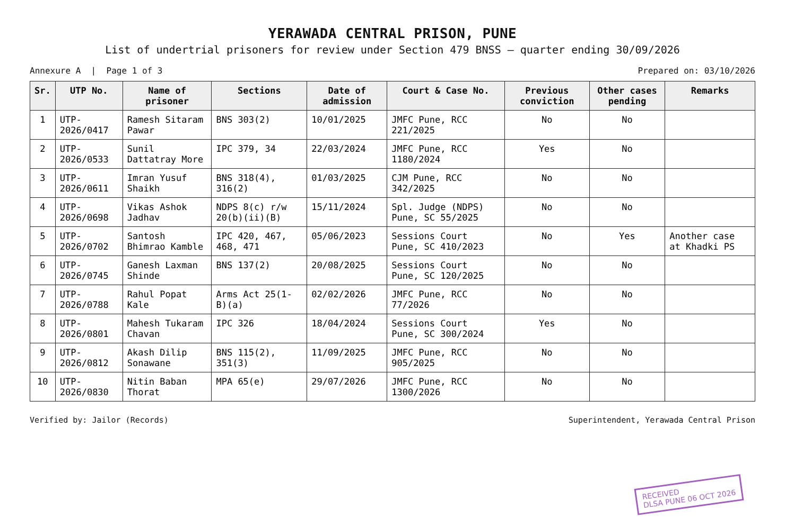
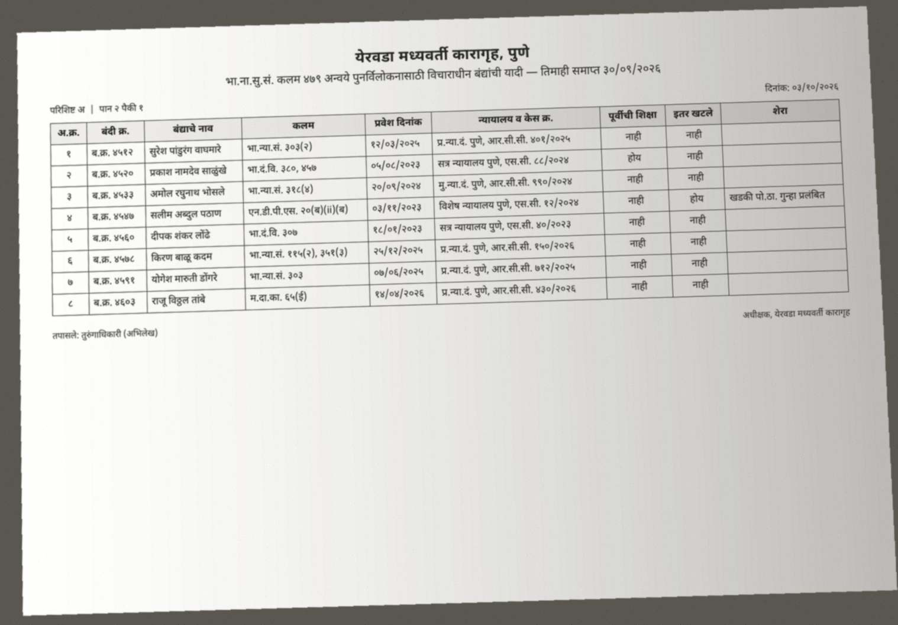
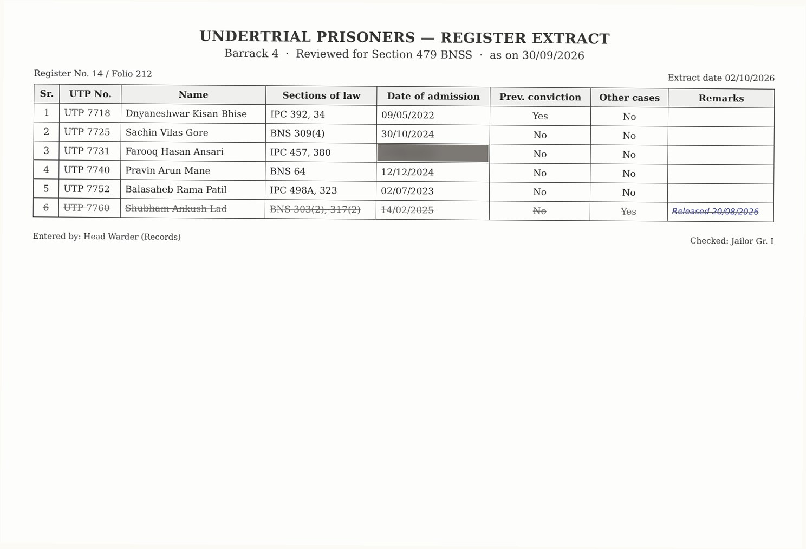

# Kaagaz (कागज़)

**A photographed page of an Indian prison register becomes a verified Section 479 BNSS release list.**
Muse Spark reads the page; a second, independent read must agree; every section is checked against a law
table before a row is accepted; the deterministic Rihai engine computes who is entitled to release and when;
a lawyer corrects and confirms. No name ever leaves the page.

Built for the Meta Global AI Developer Hackathon (26 Oct – 4 Nov 2026), Indie Developer track, theme
*Build for Your World*. Everything in this repository was written during the event; see
[What is new here](#what-is-new-here-and-what-is-not).

## The problem

Three in four people in Indian prisons are undertrials, waiting for trial. Section 479 of the Bharatiya Nagarik
Suraksha Sanhita, 2023 says an undertrial must be released on bail after serving half of the maximum sentence for
the offence charged, a first-time offender on bond after one-third, and nobody may be held beyond the maximum
term. The Supreme Court ordered every state to apply it in 2024. Between July 2024 and April 2025 only 334 people
were released under it in the whole country, because the check is done by hand, quarter by quarter, from
registers and lists like these:

| English UTRC list (scan) | Marathi list (phone photo) | Worn register page |
|---|---|---|
|  |  |  |

(All three are synthetic: invented names, numbers and cases, in the layouts the real documents use.)

The arithmetic is simple. Getting the facts off the paper, in Marathi or Hindi or English, without a single
wrong section number reaching a court, is the whole difficulty. That is what Kaagaz does.

## How it works

```
page image(s) ──► Read 1: Muse Spark, whole table, strict JSON (no name field)
             ──► Read 2: Muse Spark again, different instruction, row by row, only sections + custody date
             ──► compare: agreed / disputed
             ──► checks: every section looked up in the law table (800 rows, India Code sources);
                         dates plausible; identifier not name-like; row legible
             ──► Rihai engine: controlling section, 1/3 or 1/2, eligible date, exclusions, maximum-term cap
             ──► results sheet + UTRC memo per eligible row + raw reads for audit
             ──► a person corrects any cell against the page, confirms, re-assess (no model call)
```

Six things hold a row back for a human: the two reads disagree; a section the law table does not know; a bare
section whose sub-sections carry different sentences; a custody date missing, in the future or implausible; the
reader marked the row illegible; the identifier looks like a person's name. Held-back rows are still assessed,
so the human sees what is at stake, but their results are marked as resting on an unverified reading.

**Court order replay.** The same reader applied to a published bail order: the order's facts are extracted, the
engine runs as of the order date, and the court's decision is compared with the engine's (`agree`,
`court_liberal`, `court_strict`, `engine_abstains`). Every replayed order is a test of the law table.

**Everything is recorded.** Each live model call is written to `kaagaz_cache/` as JSON: the request text, the
image hashes, the model's answer and token counts, never the key. A run can be replayed and audited without
touching the API.

## Use of Meta's models

* `muse-spark-1.3` through the Meta Model API, OpenAI-compatible Chat Completions, image input as data URLs,
  **structured output with a strict JSON schema** (`response_format: json_schema`, `strict: true`). The schema is
  the contract: it has no field for a name, so the model cannot return one; acts are an enum; dates are ISO.
* Two reads per page with different instructions, compared deterministically. The second read is not a
  "better" read; it is an independent one, and disagreement is information.
* Multilingual pages (Marathi, Hindi, English, mixed scripts and Devanagari digits) handled by the model, with
  the normalisation rules spelled out in the system prompt (`kaagaz/extract.py`).

## Run it

```bash
git clone https://github.com/SainathGaikwad/kaagaz && cd kaagaz
pip install -r requirements.txt            # installs the Rihai engine from GitHub as a library
cp .env.example .env                       # put MODEL_API_KEY=... in .env (from https://dev.meta.ai → API keys)

kaagaz check                               # key present? does the API answer?
kaagaz read samples/register_en_clean.png  # two reads, checks, assessment; answers recorded under kaagaz_cache/
kaagaz read samples/*.jpg samples/*.png --as-of 2026-10-31 --out out/results.csv
kaagaz order samples/court_order_sample.pdf
kaagaz read samples/register_worn.jpg --replay     # recorded answers only, no key, no network
kaagaz read samples/register_worn.jpg --fake       # the samples' ground truth, no model at all (for tests)

streamlit run app.py                       # the interface: upload, read, correct, confirm, download
```

On Windows, `python -m kaagaz.cli ...` works the same as `kaagaz ...`.

Tests: `python -m pytest -q` (no network; they use the fake model and the recorded answers).

## What is new here, and what is not

Written during the hackathon (this repository, all of it): the reading schemas, the two-read protocol and
comparison, the verification layer, the court-order replay, the replay cache, the CLI, the Streamlit interface,
the synthetic sample pages and their generator, the tests.

Not written during the hackathon, used as a library: [Rihai](https://github.com/SainathGaikwad/rihai), the
author's open-source Section 479 engine and law table (MIT), installed from GitHub by `requirements.txt`. Kaagaz
calls `rihai.eligibility.assess`, `rihai.law.lookup` and `rihai.agent.draft` the way it would call any package.
Nothing of Rihai is shown as new work in the demo.

## Honest limits

* The law table has 800 rows; none has yet been ticked as verified by a lawyer against India Code, and the
  engine says so on every result that depends on an unverified row.
* The reader is as good as the photograph. A date that is smudged on the page comes back empty, not guessed.
* Section 479 arithmetic is what the statute says; the second proviso lets a court continue detention for
  reasons recorded. The tool shows the statutory date, not what a court will do.
* Real registers never go to the public internet. The hosted demo is for the samples; a real list runs on an
  office machine with the office's own key.

## Licence

MIT. The samples are fiction. The Rihai engine and law table are MIT, by the same author.
